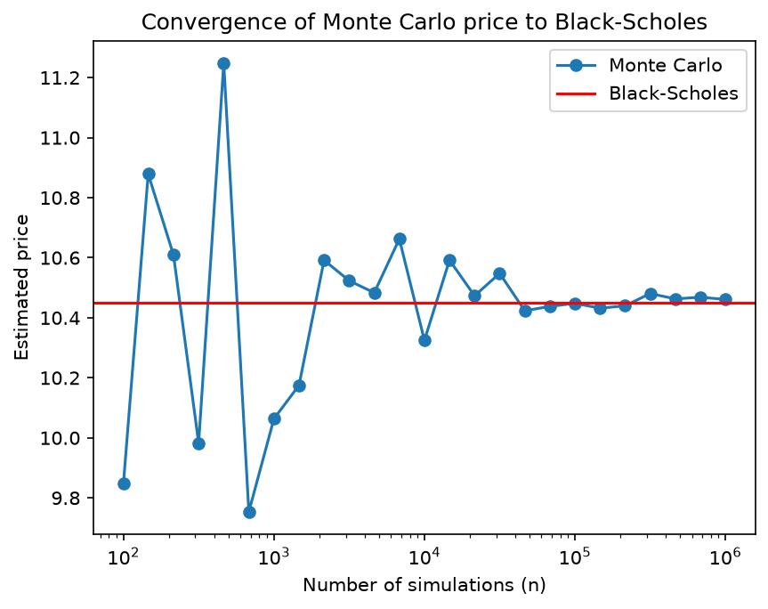

# Option Pricing: Monte Carlo vs Black-Scholes

Pricing of a European call option with two methods:
- **Monte Carlo simulation**: simulating many possible future prices and averaging the payoff
- **Black-Scholes formula**: exact closed-form price, used as a benchmark

The goal is to show that the Monte Carlo estimate converges to the Black-Scholes price as the number of simulations increases.

## Results

For an at-the-money call with S₀ = 100, K = 100, T = 1, r = 5%, σ = 20%:

| Method | Price |
|---|---|
| Black-Scholes | 10.45 |
| Monte Carlo (100,000 simulations) | ≈ 10.45 |



The Monte Carlo error decreases as $1/\sqrt{n}$: dividing the error by 10 requires 100 times more simulations.

## How to run

```bash
pip install numpy scipy matplotlib
jupyter notebook option_pricing.ipynb
```

## Next steps
- Confidence intervals for the Monte Carlo estimate
- Put options and put-call parity
- The Greeks (delta, gamma, vega)